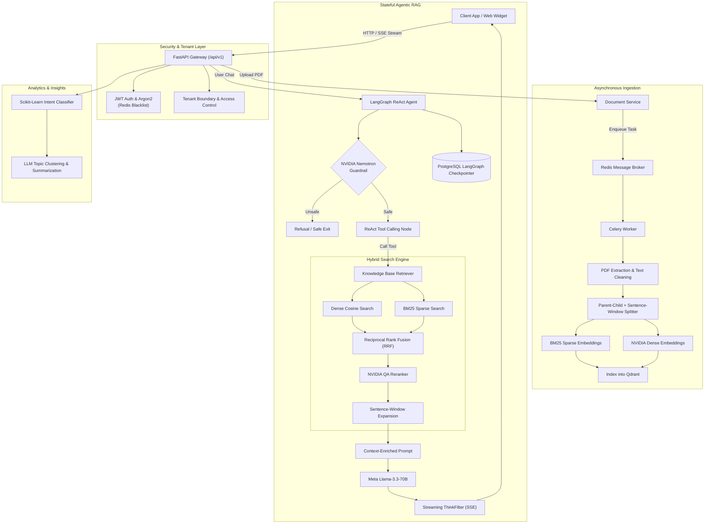

# 🧠 Knowra: Enterprise Multi-Tenant Agentic RAG Platform

[](https://fastapi.tiangolo.com)
[](https://python.org)
[](https://langchain-ai.github.io/langgraph/)
[](https://qdrant.tech)
[](https://www.postgresql.org/)
[](https://docs.celeryq.dev/)
[](src/tests)

**Knowra** is a production-ready, multi-tenant Retrieval-Augmented Generation (RAG) platform powered by stateful **LangGraph ReAct Agents**, **Hybrid Sentence-Window Retrieval**, and **Asynchronous Celery Ingestion Pipelines**.

Designed from the ground up for high-accuracy enterprise knowledge bases, Knowra solves the standard failure modes of naive RAG: lost-in-the-middle context issues, ingestion latency spikes, hallucination, and lack of tenant isolation.

---

## 🏛️ System Architecture



---

## ✨ Core Engineering Features

### 1. Hybrid Sentence-Window + Parent-Child Retrieval
Naive chunking forces a trade-off: small chunks maximize embedding specificity but starve the LLM of context, while large chunks dilute vector meaning. Knowra implements a dual-tier strategy:
- **Child Chunks (75 tokens)**: Embedded using both **NVIDIA Dense vectors** and **FastEmbed BM25 sparse vectors** for fine-grained hybrid vector matching in **Qdrant**.
- **Parent Window Context**: Upon retrieval, the neighboring parent chunks ($\pm 2$ window size) are automatically injected into the generation prompt, ensuring comprehensive context without search dilution.
- **Cross-Encoder Reranking**: Uses **NVIDIA Llama-3.2 Reranker** to re-score candidate passages before passing to the generator.

### 2. Autonomous LangGraph ReAct Agent with Guardrails
- **Stateful Memory**: Conversational threads persist state across sessions via an **Async PostgreSQL Checkpointer** (`AsyncPostgresSaver`).
- **Safety First**: Every incoming message passes through an **NVIDIA Nemotron Content Safety Guardrail** before entering the reasoning loop.
- **Streaming SSE**: Streams tokens in real-time via Server-Sent Events (`text/event-stream`), using an internal `ThinkFilter` to strip chain-of-thought `<think>` tags before delivering user-facing output.

### 3. Decoupled Asynchronous Processing (Celery + Redis)
- Document uploading, PDF text extraction (`pypdf`), chunking, and dual-embedding generation run entirely in background **Celery workers**.
- The API returns instantly with an ingestion task ID, preventing thread exhaustion on large multi-page PDF uploads.

### 4. Enterprise Security & Multi-Tenancy
- **Strict Tenant Isolation**: Data, documents, and vectors are scoped by `business_id` across PostgreSQL and Qdrant payload filters.
- **Auth & Revocation**: Password hashing via **Argon2**, access/refresh token rotation, and instant logout revocation via **Redis JTI blacklisting**.

### 5. Automated Analytics & Question Clustering
- Analyzes customer inquiries using a pre-trained **Scikit-Learn relevance pipeline** (`question_relevance_pipeline.pkl`).
- Automatically clusters business-specific questions into high-level thematic topics with actionable operational summaries.

---

## 📊 Evaluation & Testing

Knowra is comprehensively verified with a **123-test automated test suite**:
- **Unit & Integration Tests**: 100% pass rate across authentication, business management, document ingestion, conversational streaming, error handling, and security.
- **DeepEval RAG Benchmarking**: Built-in evaluation suite (`src/evals/`) measuring:
  - **Contextual Precision**: Precision of retrieved chunks against target ground truth.
  - **Faithfulness**: Absence of hallucinations against retrieved document context.
  - **Answer Relevancy**: Direct alignment with user intent.
  - **G-Eval Rubric Scoring**: Factual correctness evaluation via LLM judges.

Run the test suite locally:
```bash
pytest src/tests -v -p no:deepeval
```

---

## 🚀 Quickstart Guide

### 1. Clone & Set Up Environment
```bash
git clone https://github.com/arunpunithkumar3-a11y/Knowra-Ai.git
cd Knowra-Ai
python -m venv venv

# On Linux/macOS:
source venv/bin/activate
# On Windows:
.\venv\Scripts\activate
```

### 2. Install Dependencies
```bash
pip install -r requirements.txt
```

### 3. Configure Environment Variables
```bash
cp .env.example .env
# Fill in DATABASE_URL, REDIS_URL, QDRANT_URL, and API keys
```

### 4. Run Database Migrations
```bash
alembic upgrade head
```

### 5. Launch the Application

- **Terminal 1: Start FastAPI Web Server**
  ```bash
  uvicorn main:app --reload --port 8000
  ```

- **Terminal 2: Start Background Celery Worker**
  ```bash
  celery -A src.celery_tasks.celery_app worker --loglevel=info
  ```

### 6. Verify Services
- **FastAPI Documentation**: [http://localhost:8000/docs](http://localhost:8000/docs)
- **Health Check**: [http://localhost:8000/health](http://localhost:8000/health)

---

## 📡 API Endpoints Overview

| Category | Method | Endpoint | Description |
| :--- | :--- | :--- | :--- |
| **System** | `GET` | `/health` | Service health status and readiness check |
| **Auth** | `POST` | `/api/v1/auth/signup` | Register a new user |
| **Auth** | `POST` | `/api/v1/auth/login` | Authenticate user & issue JWT token pair |
| **Auth** | `POST` | `/api/v1/auth/refresh` | Refresh access token using refresh token |
| **Auth** | `POST` | `/api/v1/auth/logout` | Revoke tokens via Redis blacklist |
| **Business** | `POST` | `/api/v1/business` | Register a business/tenant profile |
| **Business** | `GET` | `/api/v1/business/{id}`| Fetch business details and public keys |
| **Documents**| `POST` | `/api/v1/create_document/{biz_id}` | Upload and asynchronously ingest a PDF |
| **Documents**| `GET` | `/api/v1/documents/{biz_id}` | List tenant documents and embedding status |
| **Chat** | `POST` | `/api/v1/knowra/chat/{biz_id}` | Authenticated streaming agent chat (SSE) |
| **Chat** | `POST` | `/api/v1/knowra/widget/chat/{public_key}` | Public embeddable widget chat endpoint |
| **Analytics**| `POST` | `/api/v1/feature/cluster/{biz_id}` | Topic clustering & question analytics |

Interactive OpenAPI documentation is available at `/docs` and `/redoc`.

---

## 📂 Project Structure

```text
Knowra/
├── alembic/                  # Database migration scripts (Alembic)
├── src/
│   ├── analyse/              # Scikit-Learn intent clustering & topic summarization
│   ├── api/                  # Modular FastAPI routers (auth, business, chat, doc, feature)
│   ├── core/                 # PostgreSQL engine, Redis connection pool, security & auth
│   ├── evals/                # DeepEval benchmark suites & golden datasets
│   ├── knowra/               # Core RAG engine
│   │   ├── agent/            # LangGraph ReAct workflow, nodes, tools, and streaming
│   │   ├── guardrails/       # Content safety & moderation logic
│   │   ├── pipeline.py       # Retrieval orchestrator
│   │   ├── prompt.py         # System prompts & few-shot templates
│   │   └── retrievers.py     # Sentence-window parent-child hybrid retriever
│   ├── models/               # SQLModel DB models & Pydantic request/response schemas
│   ├── services/             # Business logic layer (user, business, document, questions)
│   ├── tests/                # Comprehensive unit & integration test suite (123 tests)
│   ├── celery_tasks.py       # Asynchronous background tasks (PDF indexing, email)
│   ├── client.py             # Qdrant client singleton
│   ├── config.py             # Pydantic BaseSettings configuration
│   ├── exceptions.py         # Custom application exception hierarchy
│   ├── mail.py               # FastMail SMTP email notification service
│   └── main.py               # FastAPI application initialization & middleware
├── .env.example              # Environment variables template
├── main.py                   # Root runner entrypoint
├── requirements.txt          # Production dependencies (UTF-8)
└── README.md                 # Project documentation
```

---

## 📄 License

This project is licensed under the MIT License - see the [LICENSE](LICENSE) file for details.
